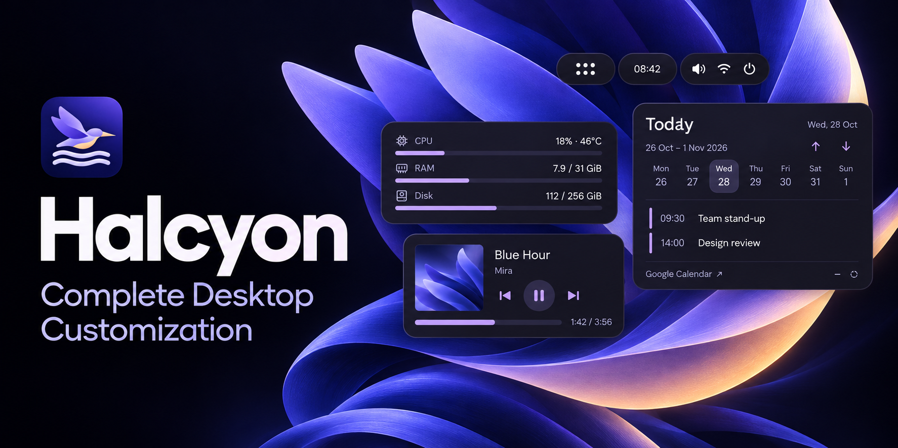
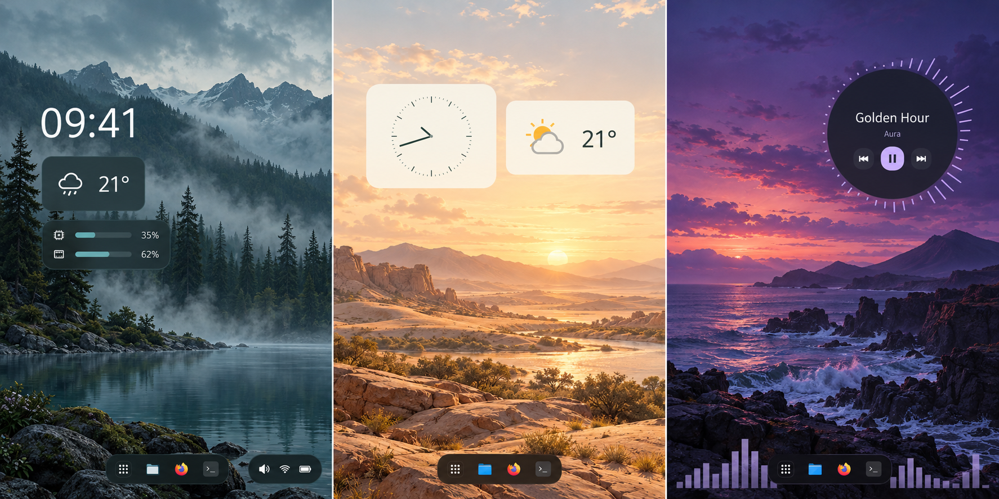
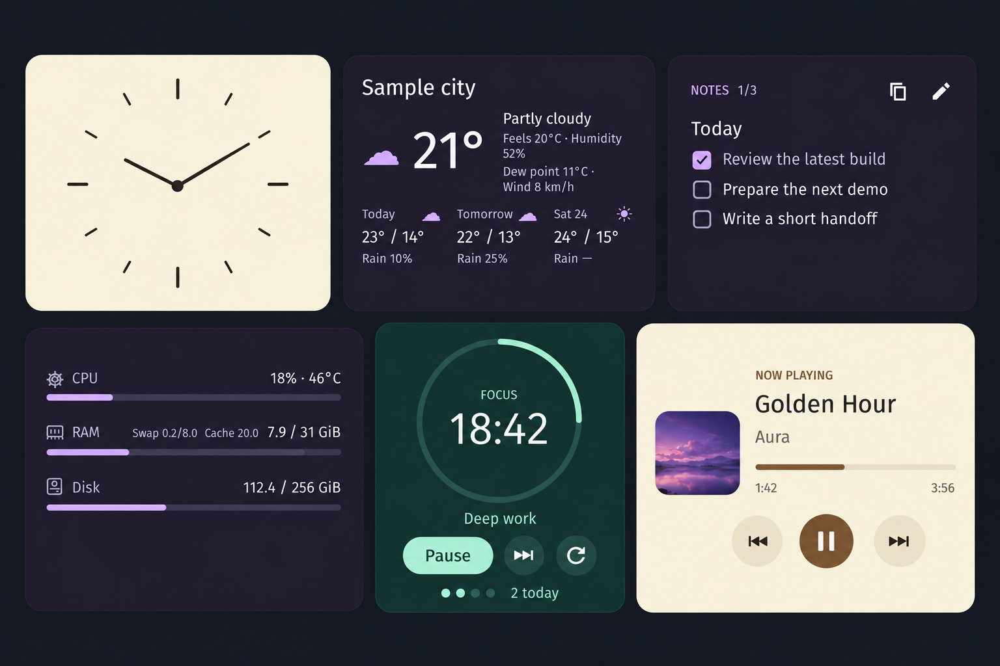
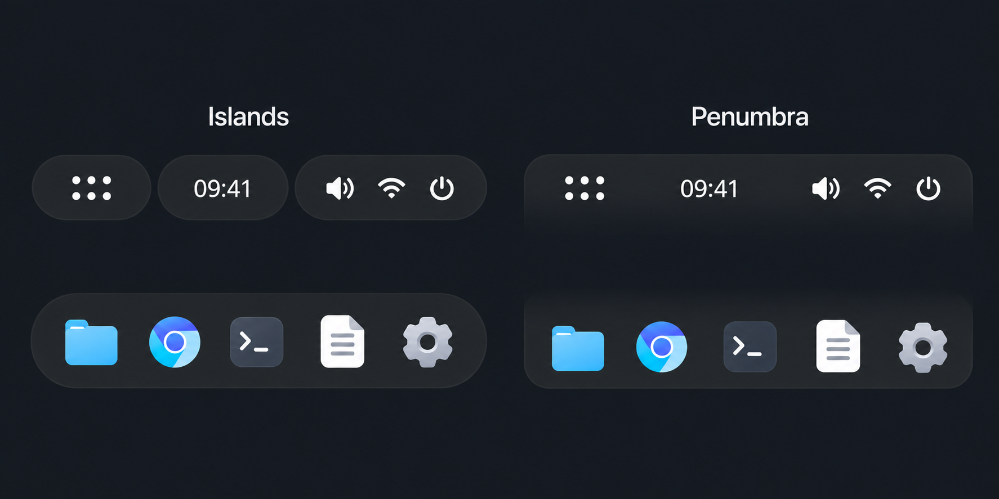
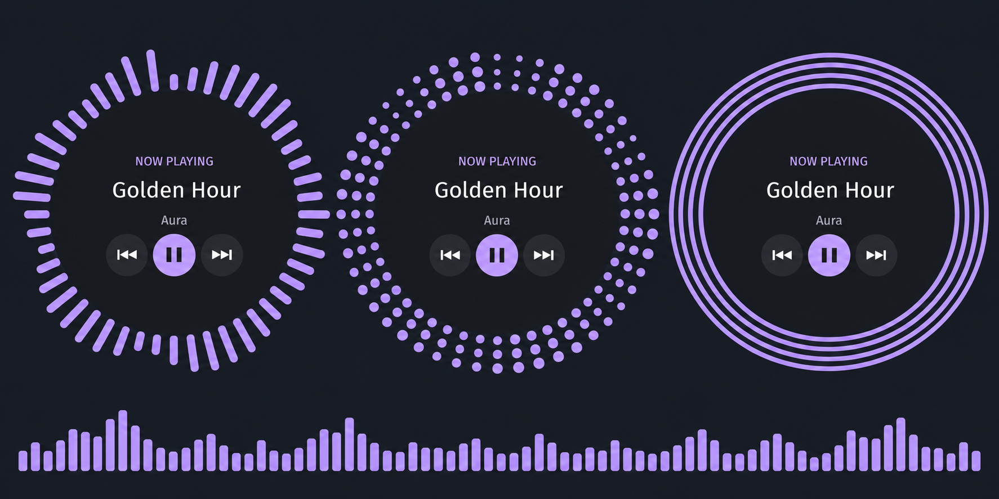
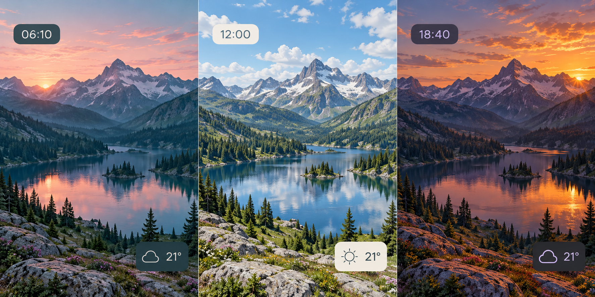

[](docs/presentation/055-readme/hero-graphic.png)

<p align="center">For the COSMIC desktop on Pop!_OS and Fedora.</p>

<p align="center">
  <a href="https://github.com/profilaz3/halcyon/releases/latest"><strong>Download</strong></a> ·
  <a href="#install">Install</a> ·
  <a href="https://github.com/profilaz3/halcyon/releases">Release notes</a> ·
  <a href="https://github.com/profilaz3/halcyon/issues">Feedback</a>
</p>

<!-- Stable product overview. See .github/README-MAINTENANCE.md. -->

A native COSMIC application built with **Rust and libcosmic**. Settings and wallpaper effects use GPU rendering.

*The hero and feature images are generated illustrations. [Native screenshots](docs/screenshots/055/README.md) and [image sources](docs/presentation/055-readme/README.md) are available separately.*

## 1. Desktop appearance

Wallpapers, light and dark themes, accent colors, fonts, icons and surface finishes. Appearance settings can be coordinated across widgets, dock and panel.

[](docs/presentation/055-readme/desktop-configurations.png)

## 2. Widget design and placement

The widget builder customizes Clock, Weather, Calendar, System monitor, Music and Focus. Notes, Git project status and Daily overview are also included. Widgets support moving, resizing, ordering and assignment to different displays.

[](docs/presentation/055-readme/widgets-elements-dark.png)

[Native widget builder](docs/screenshots/055/widget-builder.png)

## 3. Dock and panel customization

Applet arrangement, spacing, size, opacity, corners and auto-hide. **Islands** separates applets into floating groups; **Penumbra** fades bar backgrounds into the wallpaper. Both are optional and included in the package. The **Activity island** (beta) shows music, meetings, notifications and camera or microphone use in the middle of an Islands panel.

[](docs/presentation/055-readme/panel-elements-dark.png)

*Floating groups on the left; edge-attached fades on the right.* [Panel setup](packaging/islands/README.md) · [Penumbra](companion/PENUMBRA.md)

## 4. Wallpaper animation

Rain, snow, fog and cloud shadows, with effect-specific controls and three quality levels. Animation pauses on lock and sleep; pausing on battery is enabled by default.

[](docs/presentation/055-readme/wallpaper-effects.png)

## 5. Audio visualization

A spectrum with adjustable size, position and opacity, including placement behind the dock. Circular Music styles include radial bars, orbit dots and pulse rings. Visualizers use the system audio output and stop capturing when playback stops.

[](docs/presentation/055-readme/audio-elements-dark.png)

*The three Music styles are alternatives; one is selected at a time.*

## 6. Saved setups and automation

Save, combine, import and export wallpapers, styles and layouts. Rules can switch setups by time or display connection. Sun-based appearance schedules use dawn, noon, golden hour and sunset, calculated locally for a selected city.

[](docs/presentation/055-readme/scheduled-appearances.png)

[Native setup editor](docs/screenshots/040/remix.png)

## Install

Choose your package from the **[latest release](https://github.com/profilaz3/halcyon/releases/latest)**:

| Desktop | Package | Install |
| --- | --- | --- |
| Pop!_OS 24.04 with COSMIC | `.deb` · amd64 | Open with **COSMIC Store** → Install |
| Fedora 43 or 44 with COSMIC | `.rpm` · x86_64 | Install with **DNF** using the command below |

Open **Halcyon** from the application launcher and finish setup. Packages support 64-bit Intel and AMD PCs; missing dependencies may require an internet connection.

<details>
<summary>Terminal commands</summary>

Run in the folder containing the downloaded package.

**Pop!_OS**

```sh
sudo apt install ./cosmic-ext-halcyon_*_amd64.deb
```

**Fedora COSMIC** — download the `.fc43` or `.fc44` package matching your Fedora version.

```sh
sudo dnf install ./cosmic-ext-halcyon-*.x86_64.rpm
```

</details>

Fresh installations configure the signed update source. Future updates arrive through **COSMIC Store → Updates**, APT or DNF. Automatic installation follows your OS settings; disabled or modified sources stay that way.

To activate the optional panel component, open **Dock and panel**, set **Shape** to **Islands** and choose **Switch at next sign-in**, then sign out and back in when convenient. Halcyon and the panel component update together.

[Installation & updates](docs/DISTRIBUTION.md) · [Fedora package details](docs/FEDORA-PACKAGING.md)

## What Halcyon changes, and how to go back

Halcyon keeps a copy of your desktop from before its first change. Depending on what you choose in setup and Settings, it can change:

- your wallpaper, colors and theme
- dock and panel appearance (including the Islands panel)
- window, workspace and icon settings
- whether the desktop widgets start at sign-in

**To go back to stock COSMIC:** open Halcyon, go to **Changes → Before Halcyon → Desktop from before Halcyon** and choose **Restore…**. Then remove the package:

```sh
sudo apt remove cosmic-ext-halcyon   # Pop!_OS
sudo dnf remove cosmic-ext-halcyon   # Fedora
```

Removing the package alone leaves your colors and panel as they are. From a terminal, `halcyon-ctl restore` puts back your wallpaper from before Halcyon and stops the widgets, including at sign-in; `halcyon-ctl start` turns them back on.

## Command line and shortcuts

```text
halcyon                     Show the desktop widgets (only one copy runs at a time)
halcyon --settings [PAGE]   Open Settings, on PAGE if given (for example clock)
halcyon --toggle TARGET     Open or close the edge menu (drawer), or show or hide a widget
halcyon-ctl start | stop    Show or hide the widgets, now and at sign-in
halcyon-ctl focus toggle    Start or pause the Focus timer
halcyon-ctl --help          Every command, described
```

Bind `halcyon --toggle drawer` to a key in **COSMIC Settings → Keyboard → Keyboard shortcuts** to open the edge menu without the mouse. In the menu, Tab and the arrow keys move, Enter shows or hides a widget, Alt+Up and Alt+Down reorder the right column, and Esc closes it. Right-click any widget for its settings, Arrange, or Hide. `man halcyon` and `man halcyon-ctl` have the details.

## Help & development

[Calendar setup](docs/CALENDAR.md) · [Report a bug](https://github.com/profilaz3/halcyon/issues) · [Build & contribute](docs/DEVELOPMENT.md) · [Privacy](docs/PRIVACY.md)

[GPL-3.0-or-later](LICENSE) · [Third-party notices](THIRD_PARTY.md) · [Screenshots](docs/screenshots/055/README.md) · [Illustration sources](docs/presentation/055-readme/README.md)
