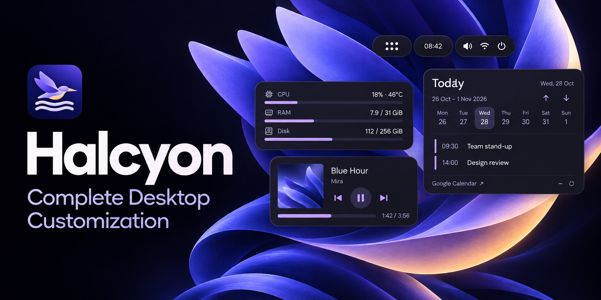
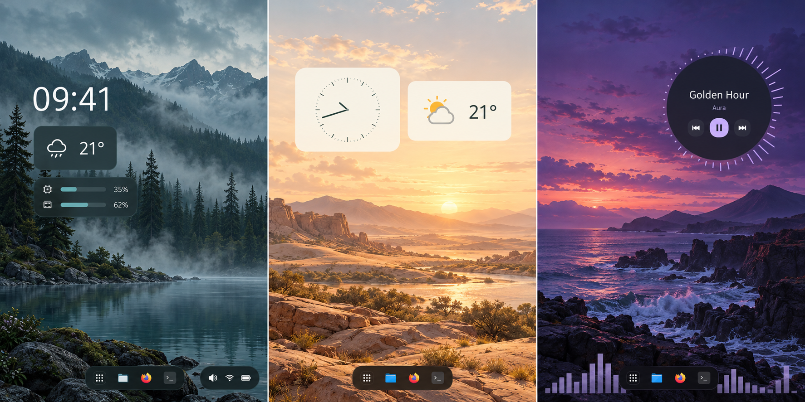
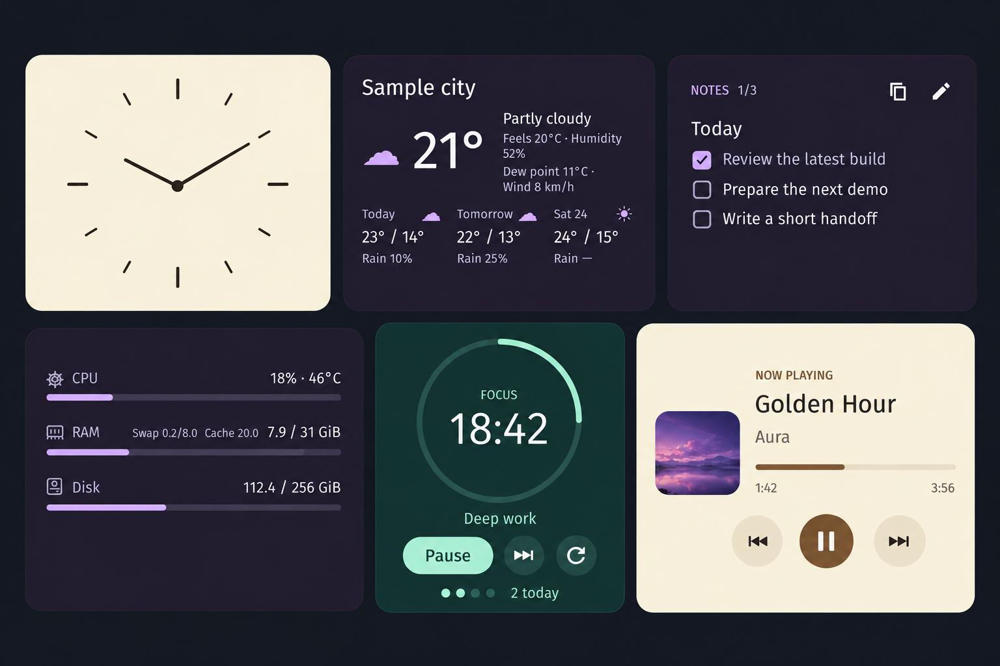
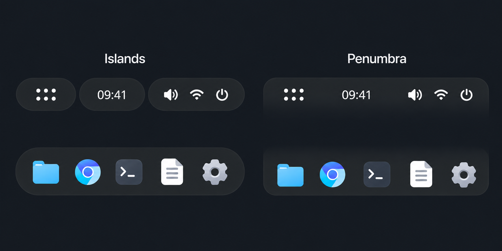
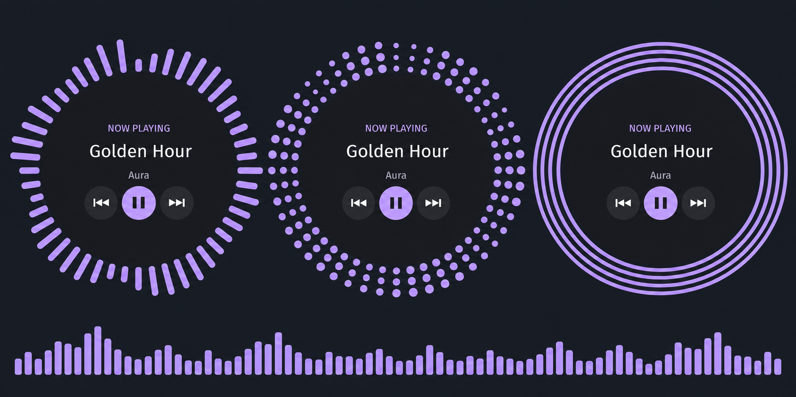
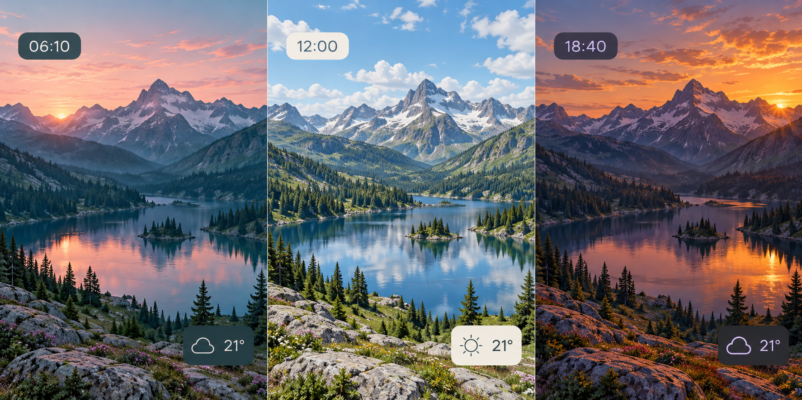

[](docs/presentation/055-readme/hero-graphic.png)

<p align="center">For the COSMIC desktop on Pop!_OS and Fedora.</p>

<p align="center">
  <a href="https://github.com/profilaz3/halcyon/releases/latest"><strong>Download</strong></a> ·
  <a href="#install">Install</a> ·
  <a href="https://github.com/profilaz3/halcyon/releases">Release notes</a> ·
  <a href="https://github.com/profilaz3/halcyon/issues">Feedback</a>
</p>

<!-- Stable product overview. See .github/README-MAINTENANCE.md. -->

A native COSMIC application built with **Rust and libcosmic**. Settings and wallpaper effects use GPU rendering.

*The hero and feature images are generated illustrations. [Native screenshots](docs/screenshots/055/README.md) and [image sources](docs/presentation/055-readme/README.md) are available separately.*

## 1. Desktop appearance

Wallpapers, light and dark themes, accent colors, fonts, icons and surface finishes. Appearance settings can be coordinated across widgets, dock and panel.

[](docs/presentation/055-readme/desktop-configurations.png)

## 2. Widget design and placement

The widget builder customizes Clock, Weather, Calendar, System monitor, Music and Focus. Notes, Git project status and Daily overview are also included. Widgets support moving, resizing, ordering and assignment to different displays.

[](docs/presentation/055-readme/widgets-elements-dark.png)

[Native widget builder](docs/screenshots/055/widget-builder.png)

## 3. Dock and panel customization

Applet arrangement, spacing, size, opacity, corners and auto-hide. **Islands** separates applets into floating groups; **Penumbra** fades bar backgrounds into the wallpaper. Both are optional and included in the package.

[](docs/presentation/055-readme/panel-elements-dark.png)

*Floating groups on the left; edge-attached fades on the right.* [Panel setup](packaging/islands/README.md) · [Penumbra](companion/PENUMBRA.md)

## 4. Wallpaper animation

Rain, snow, fog and cloud shadows, with effect-specific controls and three quality levels. Animation pauses on lock and sleep; pausing on battery is enabled by default.

[](docs/presentation/055-readme/wallpaper-effects.png)

## 5. Audio visualization

A spectrum with adjustable size, position and opacity, including placement behind the dock. Circular Music styles include radial bars, orbit dots and pulse rings. Visualizers use the system audio output and stop capturing when playback stops.

[](docs/presentation/055-readme/audio-elements-dark.png)

*The three Music styles are alternatives; one is selected at a time.*

## 6. Saved setups and automation

Save, combine, import and export wallpapers, styles and layouts. Rules can switch setups by time or display connection. Sun-based appearance schedules use dawn, noon, golden hour and sunset, calculated locally for a selected city.

[](docs/presentation/055-readme/scheduled-appearances.png)

[Native setup editor](docs/screenshots/040/remix.png)

## Install

Choose your package from the **[latest release](https://github.com/profilaz3/halcyon/releases/latest)**:

| Desktop | Package | Install |
| --- | --- | --- |
| Pop!_OS 24.04 with COSMIC | `.deb` · amd64 | Open with **COSMIC Store** → Install |
| Fedora 43 with COSMIC | `.rpm` · x86_64 | Install with **DNF** using the command below |

Open **Halcyon** from the application launcher and finish setup. Packages support 64-bit Intel and AMD PCs; missing dependencies may require an internet connection.

<details>
<summary>Terminal commands</summary>

Run in the folder containing the downloaded package.

**Pop!_OS**

```sh
sudo apt install ./cosmic-ext-halcyon_*_amd64.deb
```

**Fedora COSMIC**

```sh
sudo dnf install ./cosmic-ext-halcyon-*.x86_64.rpm
```

</details>

Fresh installations configure the signed update source. Future updates arrive through **COSMIC Store → Updates**, APT or DNF. Automatic installation follows your OS settings; disabled or modified sources stay that way.

To activate the optional panel component, open **Desktop → Dock & panel → Enable for next login**, then log out and back in when convenient. Halcyon and the panel component update together.

[Installation & updates](docs/DISTRIBUTION.md) · [Fedora package details](docs/FEDORA-PACKAGING.md)

## Help & development

[Calendar setup](docs/CALENDAR.md) · [Report a bug](https://github.com/profilaz3/halcyon/issues) · [Build & contribute](docs/DEVELOPMENT.md) · [Privacy](docs/PRIVACY.md)

[GPL-3.0-or-later](LICENSE) · [Third-party notices](THIRD_PARTY.md) · [Screenshots](docs/screenshots/055/README.md) · [Illustration sources](docs/presentation/055-readme/README.md)
