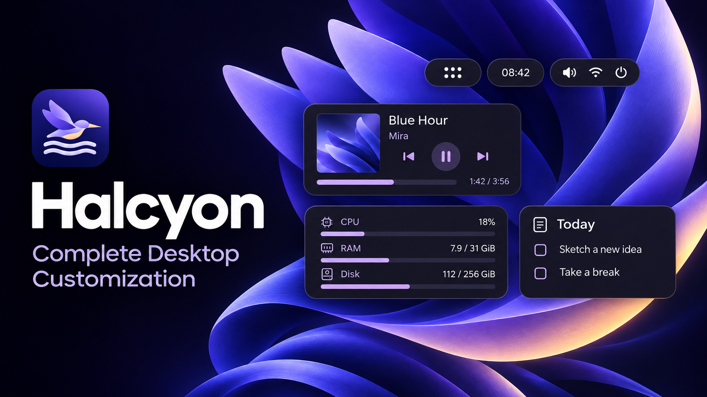
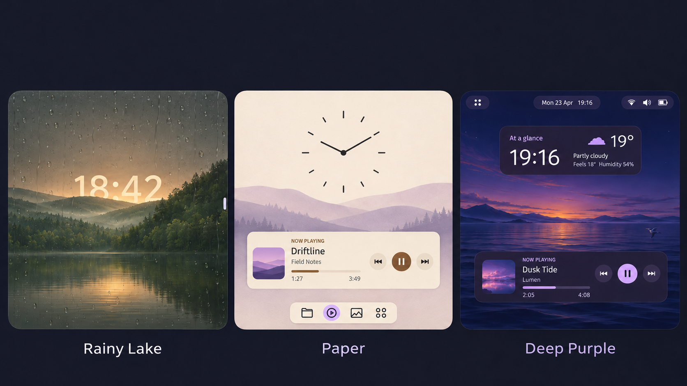
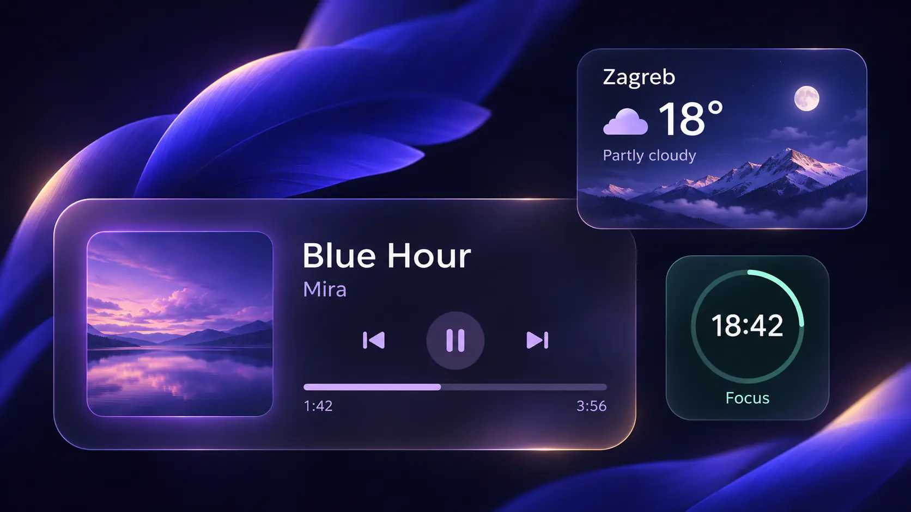
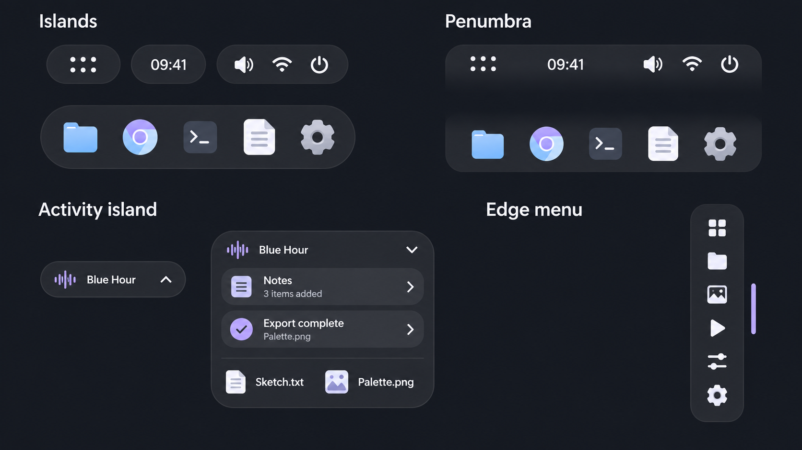
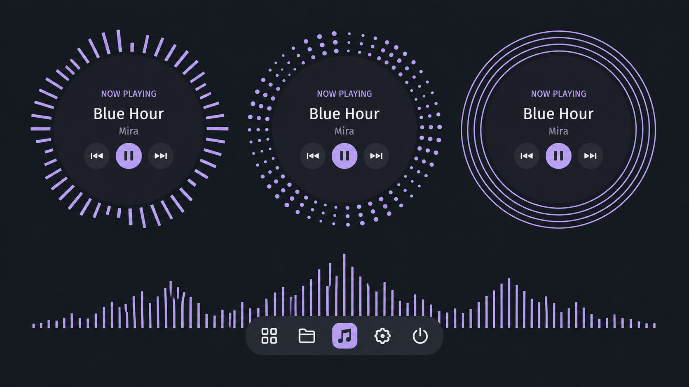
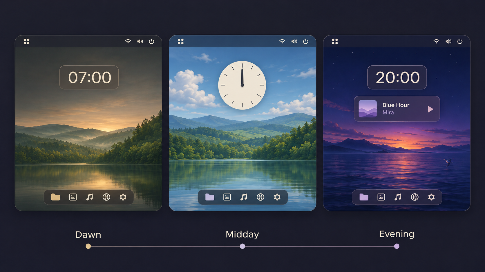
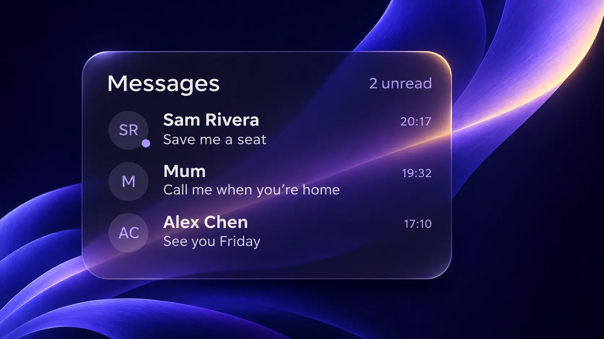
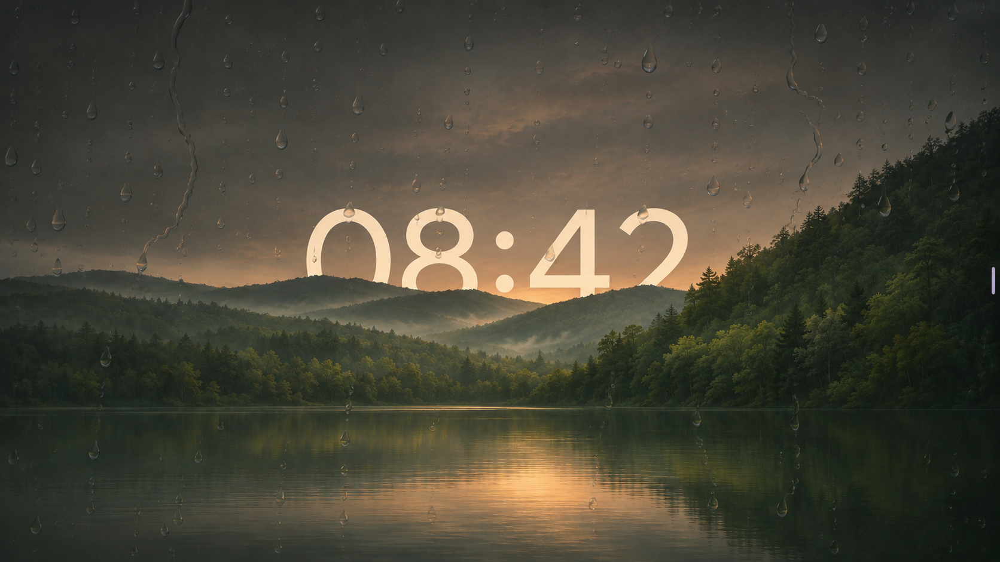
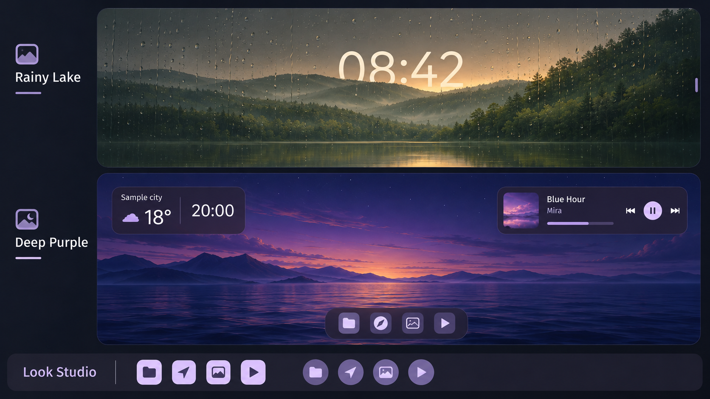

[](docs/presentation/070-readme/hero-graphic.png)

<p align="center">For the COSMIC desktop on Pop!_OS and Fedora.</p>

<p align="center">
  <a href="https://github.com/profilaz3/halcyon/releases/latest"><strong>Download</strong></a> ·
  <a href="#2-widget-design-and-placement">Widgets</a> ·
  <a href="#7-clock-depth-and-rain-on-glass">Glass and depth</a> ·
  <a href="#install">Install</a> ·
  <a href="https://github.com/profilaz3/halcyon/releases">Release notes</a> ·
  <a href="https://github.com/profilaz3/halcyon/issues">Feedback</a>
</p>

<!-- Stable product overview. See .github/README-MAINTENANCE.md. -->

Music picks up the color of its album cover. Glass widgets catch the wallpaper along their edges. The dock grows under the pointer. Halcyon brings these effects, desktop widgets and saved Looks to COSMIC with **Rust and libcosmic**. [Native screenshots](docs/screenshots/078/README.md)

## 1. Desktop appearance

Carry one finish across widgets, dock and panel. **Mica Slate** pairs blue-gray glass with shallow corners, **Tape Deck** uses smoked charcoal and amber accents, and **Porcelain** sets cobalt against light ceramic. Save your own colors, fonts and surface choices alongside the built-in styles.

[](docs/presentation/070-readme/desktop-configurations.png)

## 2. Widget design and placement

An album-lit Music player, a Weather forecast and a Focus timer can share a display. Resize a widget and its contents reflow. **Widget Peek** brings your chosen widgets over the current window with a button or shortcut.

[](docs/presentation/078-readme/widgets.webp)

Choose **Classic** or **Outlook** for Weather. **Folder** opens recent files, and **Markets** follows up to five stocks or currency pairs with optional charts. [Native widget gallery](docs/screenshots/078/README.md#desktop-widgets) · [Widget Peek in use](docs/screenshots/desktop-customization/widget-peek.png) · [Markets setup](docs/MARKETS.md)

## 3. Dock and panel customization

Arrange applets and adjust spacing, size, opacity, corners and auto-hide. Optional **Dock magnification** enlarges icons under the pointer and follows system reduced motion. [See the dock in motion](docs/screenshots/desktop-customization/dock-motion.mp4)

**Islands** separates applets into floating groups; **Penumbra** fades bar backgrounds into the wallpaper. Both are optional and included in the package. The **Activity island** (beta) shows music, meetings, notifications and camera or microphone use on a standard COSMIC top panel or a floating Islands panel. Open Music or Messages in the Activity island and choose **Pin to desktop**. Click to place the widget, or use the arrow keys and Enter. Esc cancels. **Show on desktop** highlights a widget you already pinned.

[](docs/presentation/070-readme/panel-elements-dark.png)

*Islands and Penumbra above; Activity island and edge menu below.* [Panel setup](packaging/islands/README.md) · [Penumbra](companion/PENUMBRA.md)

## 4. Wallpaper animation

Rain, snow, fog and cloud shadows, with effect-specific controls and three quality levels. Animation pauses on lock and sleep; pausing on battery is enabled by default.

[](docs/presentation/070-readme/wallpaper-effects.png)

## 5. Audio visualization

A spectrum with adjustable size, position and opacity, including placement behind the dock. Circular Music styles include radial bars, orbit dots and pulse rings. Visualizers use the system audio output and stop capturing when playback stops. On dark Music cards, album artwork casts a soft reflection that changes color with the track. You can switch off **Album lighting** in Music settings.

[](docs/presentation/070-readme/audio-elements-dark.png)

*The three Music styles are alternatives; one is selected at a time.*

## 6. Saved setups and automation

Save, combine, import and export wallpapers, styles and layouts. Rules can switch setups by time or display connection. Sun-based appearance schedules use dawn, noon, golden hour and sunset, calculated locally for a selected city.

[](docs/presentation/070-readme/scheduled-appearances.png)

[Native setup editor](docs/screenshots/040/remix.png)

## 7. Clock depth and rain on glass

With **Crystal** glass, a bright line in your wallpaper bends around the widget’s edge and lends the rim its color. The wallpaper stays aligned behind the text. **Frosted** softens the view, and **Rain** adds moving droplets.

[](docs/presentation/078-readme/crystal-glass.webp)

Open **Weather effects → Widget glass** to adjust frost, refraction, tint and corners. Share a named finish across widgets or give one its own copy. [See Crystal on the native Messages widget](docs/screenshots/desktop-customization/crystal-feather.webp) · [Compare Crystal and Frosted](docs/screenshots/078/README.md#glass-finishes)

The clock can sit behind the mountains in the wallpaper, between the sky and the ridge. It stays behind the ridge when effects are on, with rain on glass in front of the clock and landscape.

[](docs/presentation/070-readme/depth-clock-rain.png)

## 8. Looks

Looks coordinate wallpaper, colors, widgets, bars and effects in one pick. **Rainy Lake** combines the fog wallpaper, rain, a clock behind the mountains and autohiding bars. **Deep Purple** pairs the night wallpaper with At a glance and Music. **Look Studio** adjusts icon shape and tint. To attach apps, select a saved Look and open **Choose apps…**. **Start workspace** applies the Look and launches the apps in your chosen order. [Workspace app picker](docs/screenshots/desktop-customization/workspace-apps.png)

[](docs/presentation/070-readme/looks.png)

*The hero and feature panels are illustrations.* [Artwork and references](docs/presentation/078-readme/README.md) · [Native screenshots](docs/screenshots/078/README.md)

## Install

Choose your package from the **[latest release](https://github.com/profilaz3/halcyon/releases/latest)**:

| Desktop | Package | Install |
| --- | --- | --- |
| Pop!_OS 24.04 with COSMIC | `.deb` · amd64 | Open with **COSMIC Store** → Install |
| Fedora 43 or 44 with COSMIC | `.rpm` · x86_64 | Install with **DNF** using the command below |

Open **Halcyon** from the application launcher and finish setup. Packages support 64-bit Intel and AMD PCs; missing dependencies may require an internet connection.

<details>
<summary>Terminal commands</summary>

Run in the folder containing the downloaded package.

**Pop!_OS**

```sh
sudo apt install ./cosmic-ext-halcyon_*_amd64.deb
```

**Fedora COSMIC**: download the `.fc43` or `.fc44` package matching your Fedora version.

```sh
sudo dnf install ./cosmic-ext-halcyon-*.x86_64.rpm
```

</details>

Fresh installations configure the signed update source. Future updates arrive through **COSMIC Store → Updates**, APT or DNF. Automatic installation follows your OS settings; disabled or modified sources stay that way.

To activate the optional Islands panel, open **Home** or **Activity island** and choose **Switch at next sign-in**. Sign out and back in when convenient. Once the panel is active, choose **Panel layout** on Home to set its shape, or open **Activity island** to add it to your top panel. Halcyon and the panel component update together.

[Installation & updates](docs/DISTRIBUTION.md) · [Fedora package details](docs/FEDORA-PACKAGING.md)

## What Halcyon changes, and how to go back

Halcyon keeps a copy of your desktop from before its first change. Depending on what you choose in setup and Settings, it can change:

- your wallpaper, colors and theme
- dock and panel appearance (including the Islands panel)
- window, workspace and icon settings
- whether the desktop widgets start at sign-in

**To go back to stock COSMIC:** open Halcyon, go to **Halcyon → Running and startup → Stop using Halcyon**. It puts back your desktop from before Halcyon, stops the widgets, including at sign-in, and shows the command that removes the package:

```sh
sudo apt remove cosmic-ext-halcyon   # Pop!_OS
sudo dnf remove cosmic-ext-halcyon   # Fedora
```

Removing the package alone leaves your colors and panel as they are. From a terminal, `halcyon-ctl restore` puts back your wallpaper from before Halcyon and stops the widgets, including at sign-in; `halcyon-ctl start` turns them back on.

## Command line and shortcuts

```text
halcyon                     Show the desktop widgets (only one copy runs at a time)
halcyon --settings [PAGE]   Open Settings, on PAGE if given (for example clock)
halcyon --toggle TARGET     Open or close the edge menu (drawer), or show or hide a widget
halcyon-ctl start | stop    Show or hide the widgets, now and at sign-in
halcyon-ctl focus toggle    Start or pause the Focus timer
halcyon-ctl --help          Every command, described
```

Bind `halcyon --toggle drawer` to a key in **COSMIC Settings → Keyboard → Keyboard shortcuts** to open the edge menu without the mouse. In the menu, Tab and the arrow keys move, Enter shows or hides a widget, Alt+Up and Alt+Down reorder the right column, and Esc closes it. On a visible Music, Notes, Focus, Messages or Markets entry, Shift+Enter moves keyboard focus to the widget. Tab moves between its controls, Enter activates one, and Esc releases focus. On Calendar, Daily Overview with an agenda, System Monitor, or Projects, Shift+Enter opens the full reading. The same actions are in each widget’s right-click menu. `man halcyon` and `man halcyon-ctl` have the details.

## Help & development

[Calendar setup](docs/CALENDAR.md) · [Report a bug](https://github.com/profilaz3/halcyon/issues) · [Build & contribute](docs/DEVELOPMENT.md) · [Privacy](docs/PRIVACY.md)

[GPL-3.0-or-later AND GPL-3.0-only](LICENSE) · [Third-party notices](THIRD_PARTY.md) · [Native screenshots](docs/screenshots/078/README.md) · [Illustration sources](docs/presentation/070-readme/README.md)
