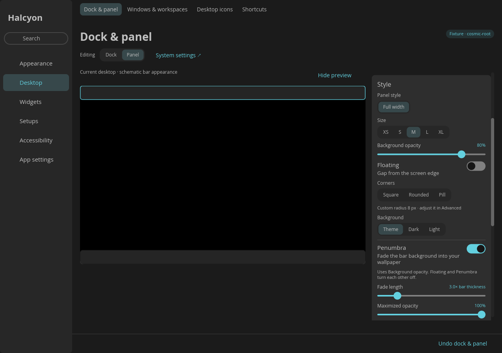

# Penumbra panel mod

[Penumbra Panel](https://github.com/motixo/penumbra-panel) gives COSMIC bars a
theme-aware background that fades into the wallpaper. In Halcyon it is an
independent optional mod, with its own **Penumbra** control inside **Style** on
**Desktop → Dock & panel**. Choose Dock or Panel and switch **Penumbra** on or off. Each bar
has a separate preference. The switch follows the editor's normal action and
persistent Undo path; another program's newer edits are protected.

Enabling Penumbra reveals **Fade length** and **Maximized opacity** inside the
same Style card. Turning it off hides those controls while keeping their saved
values. Fade length is relative to bar thickness; ordinary gradient strength
uses the existing **Background opacity** control.



Penumbra works with Standard layout. Enabling it does not enable Islands,
change applets, or rewrite an Islands sidecar.
Islands remains the separate applet-layout mod. The two mods can share a panel
process and can be enabled independently for either bar. Individual island
backgrounds and input regions remain owned by Islands above Penumbra's
click-through scrim.

The gradient supports all four screen edges, light and dark theme colors,
Background opacity, display scaling, auto-hide and maximize/restore fades.
Its extent scales with the bar thickness. **Floating** and **Penumbra** are
mutually exclusive: enabling either disables the other in the same action.
Penumbra removes the floating edge gap; Floating restores its normal gap.
Undo restores both choices together, including their previous edge gap.
Islands initially chooses Floating; enabling Penumbra afterwards keeps the
Islands layout and brings the bar flush with the screen edge. Maximized
styling continues to respect **Keep style on maximize**.

## Build the shared panel host

Both mods replace COSMIC Panel, so they must run in one host. Do not stack
the standalone Penumbra installer over Halcyon's panel selector. Halcyon
controls the gradient directly; no patched COSMIC Settings binary is needed.

The native integration is a separate patch applied after the Islands patch:

```sh
python3 companion/build.py --with-penumbra \
  --workdir /absolute/path/to/new-panel-source \
  --target-dir /absolute/path/to/panel-target
```

The builder downloads and verifies the same pinned upstream archive as
Islands. `--archive`, `--offline` and `--prepare-only` also work with this flag.
Omitting `--with-penumbra` preserves the existing Islands build and its reviewed
source identities. The layout protocol stays at version 1; a separate read-only
probe advertises Penumbra support. Older panel components continue to support
Islands and show the Penumbra control as unavailable. An already saved gradient
can still be disabled without the component running.

A new native binary needs fresh bundle provenance and final-package acceptance
through the existing [compatibility process](../docs/COMPATIBILITY.md) before
distribution. This patch does not qualify a new binary by reusing the released
Islands binary's hashes or hardware evidence. After installing an accepted
component, log out and back in; the running desktop is never restarted by a
gradient switch.

## Preferences and removal

Penumbra keeps its existing RON record at
`com.system76.CosmicPanel.<bar>/v1/top_edge_gradient`, including its legacy
fields. Toggling changes only `enabled`; saved fade extent and maximized
appearance are retained. Missing preferences stay absent until enabled.
Unknown or malformed records are preserved and shown as unsupported.

Switch **Penumbra** off to stop drawing it. Islands and native panel
settings remain available. Returning to a stock panel or a component without
Penumbra support leaves saved gradient preferences in place for a later
reinstall. Existing themes and profile exports do not capture this optional
mod or implicitly turn it on.

## Development checks

```sh
CARGO_PROFILE_DEV_DEBUG=0 cargo test --locked --bin halcyon penumbra -- --test-threads=1
cd /absolute/path/to/new-panel-source
cargo test --locked -p cosmic-panel-bin edge_gradient -- --test-threads=1
```

The native tests exercise edge geometry, theme/opacity behavior, transitions,
auto-hide and saved preferences. Native desktop acceptance must also check
Standard, Islands Together and Islands Separate on real supported sessions.
The original renderer is from Penumbra Panel revision `3ef32c8`; see
[third-party notices](../THIRD_PARTY.md).
