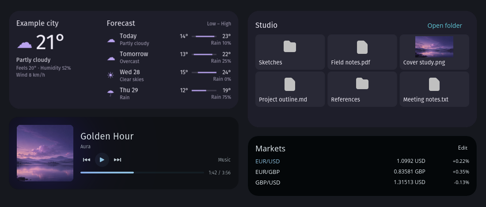
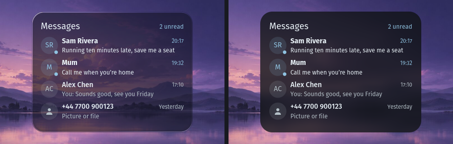

# Halcyon 0.7.8 native gallery

## Desktop widgets



| Widget | What the capture shows |
| --- | --- |
| Weather | Classic at 560 × 240 with a four-day forecast and aligned temperature ranges. The gallery scales this capture to 520 pixels wide. |
| Folder | A local folder in its wide tile layout. The example files include an image preview. |
| Music | The paused example track *Golden Hour* by Aura, with the bundled evening wallpaper as its cover and album lighting enabled. |
| Markets | A three-pair watchlist using the European Central Bank rates published on November 19, 2026. The chart and source details are switched off. |

Each card is rendered by Halcyon and placed on a charcoal background. Weather readings, filenames and track metadata are examples.

## Glass finishes



Crystal on the left reveals the ridgeline behind the messages. Frosted on the right softens it. Both use the same widget size, example conversations and bundled evening wallpaper. Each panel is the same crop of a native GPU-rendered frame.

## Capture

From the repository root, with the normal build prerequisites and a working wgpu renderer, run the following commands. The last test fetches public ECB data and its values will change with the publication date.

```sh
export DESKTOP_CARDS_LAYOUT_EVIDENCE="$(mktemp -d)"
export HALCYON_CUSTOMIZATION_EVIDENCE=1 HALCYON_RAIN_GPU_TEST=1
cargo test --release --locked --bin halcyon -- --test-threads=1 \
  classic_reflows_the_forecast folder_native_compact_and_wide \
  crystal_keeps_music_and_focus_aligned widget_glass_refracts_only_inside
cargo test --release --locked --bin halcyon -- --test-threads=1 --ignored \
  markets_live_ecb_rates_and_native_layouts_without_credentials
```

The widget gallery uses `classic-reflow-560x240.png`, `folder-wide.png`, `music-with-artwork.png` and `ecb-watchlist-wide.png`. Each glass panel uses the 446 × 286 region starting at (97, 57) in its 640 × 400 `widget-glass-crystal.png` or `widget-glass-frosted.png` capture.
